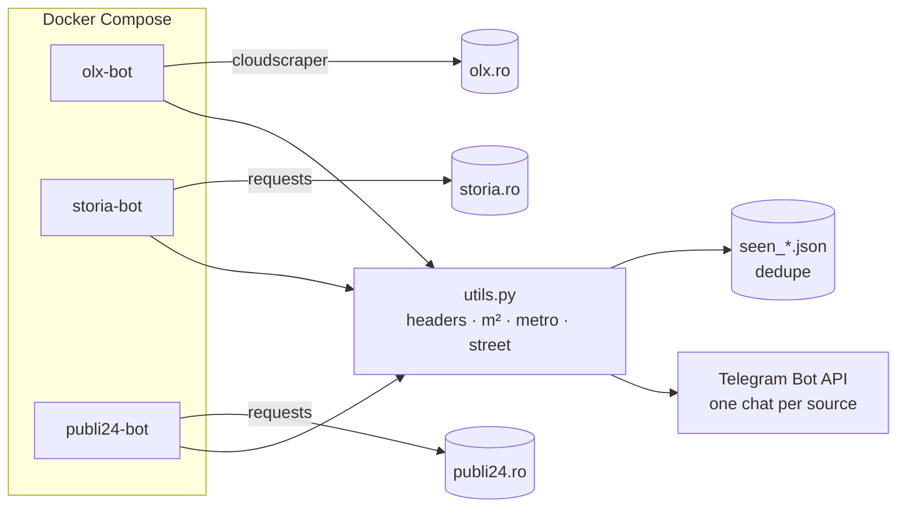

<div align="center">


<sub><a href="#-why">Why</a> &nbsp;·&nbsp; <a href="#-how-it-works">How it works</a> &nbsp;·&nbsp; <a href="#-what-an-alert-looks-like">Alerts</a> &nbsp;·&nbsp; <a href="#-run-it">Run it</a></sub>

</div>

<br/>

> Good apartments in Bucharest are gone within hours. Instead of refreshing three listing sites,
> three small workers watch them around the clock, filter by budget, size and building age,
> enrich each new listing with the nearest metro station and street, and push it to Telegram within the hour.

## ◆ &nbsp;Why

The big portals each have their own filters, their own "new" badge and no shared alerting. This project normalises
all three into one feed with the same fields, deduplicated, so the only thing left to do is open the link.

## ◆ &nbsp;How it works



<table>
  <tr>
    <td width="33%" valign="top">
      <h4>🎯 Targeted search</h4>
      <p>Each worker hits a pre-filtered results page: price band, minimum area, building year and recency, per site.</p>
    </td>
    <td width="33%" valign="top">
      <h4>🧩 Enrichment</h4>
      <p>Opens every new listing and extracts surface area, the nearest of 50+ metro stations and the street name.</p>
    </td>
    <td width="33%" valign="top">
      <h4>🔁 Exactly-once alerts</h4>
      <p>Seen listing IDs persist to disk, so restarts never re-send old listings; a scan summary closes every cycle.</p>
    </td>
  </tr>
  <tr>
    <td width="33%" valign="top">
      <h4>🤝 Polite crawling</h4>
      <p>Realistic, rotating request headers with referers, 4–8 s random pauses between listings and a jittered ~1 h cycle.</p>
    </td>
    <td width="33%" valign="top">
      <h4>🩺 Watched</h4>
      <p>Every loop touches a heartbeat file; a Docker healthcheck flags a worker as unhealthy after 90 min of silence, so a stuck loop shows up immediately; crashes restart automatically.</p>
    </td>
    <td width="33%" valign="top">
      <h4>🔐 Config in env</h4>
      <p>Bot token and per-source chat IDs come from <code>.env</code>; nothing secret lives in the code.</p>
    </td>
  </tr>
</table>

## ◆ &nbsp;What an alert looks like

```text
🏢 [STORIA] ANUNȚ NOU
━━━━━━━━━━━━━━━━━━
💰 Preț: 98 500 €
📐 Suprafață: 54 mp
📍 Zonă: Titan
🚇 Metrou: Nicolae Grigorescu
🛣️ Stradă: Bulevardul Nicolae Grigorescu
🕒 Ora: 09:14 - 15/10/2026
━━━━━━━━━━━━━━━━━━
🔗 Vezi detalii pe site
```

<sub>Example values. Alerts are in Romanian, the language of the listings.</sub>

## ◆ &nbsp;Run it

```sh
cp .env.example .env           # bot token from @BotFather + one chat ID per source
docker compose up -d --build   # olx-bot, storia-bot, publi24-bot
docker compose logs -f         # watch the scans
```

To change what is searched, edit the `URL` at the top of each `*_scraper.py`: it is the site's own results page
with your filters applied.

## ◆ &nbsp;Project layout

```
olx_scraper.py        OLX worker (cloudscraper to get past the anti-bot layer)
storia_scraper.py     Storia worker
publi24_scraper.py    Publi24 worker
utils.py              Telegram sender, header rotation, m² / metro / street extraction
Dockerfile            python:3.11-slim + requests, beautifulsoup4, cloudscraper, pytz
docker-compose.yml    three services, heartbeat healthchecks, restart: always
```

## ◆ &nbsp;Tech


<br/>

<div align="center">
<sub>Built by <a href="https://github.com/EduardEnache"><b>Eduard-Florentin Enache</b></a> &nbsp;·&nbsp; Data · BI · AI product builder</sub>

</div>
